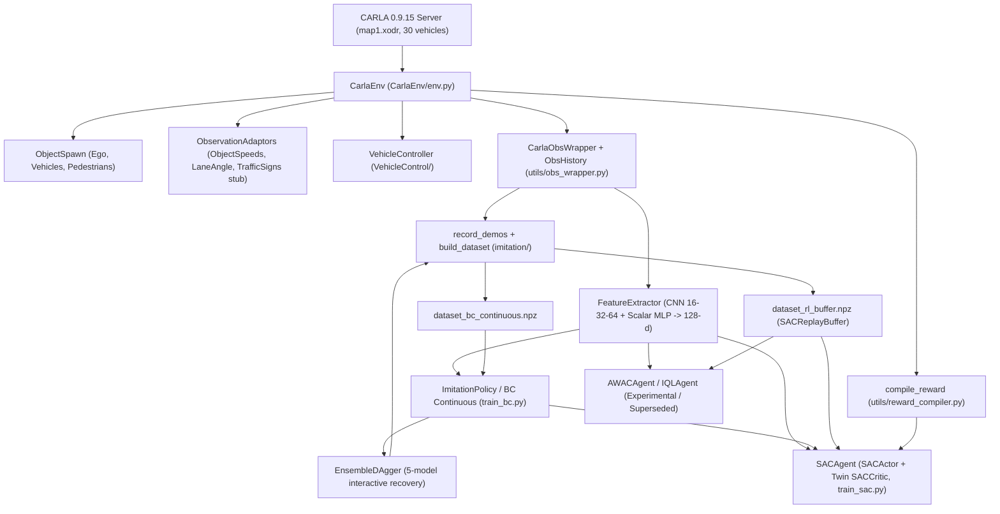
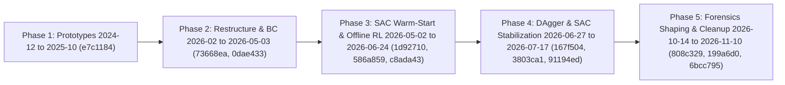

# Technical & Historical Engineering Report: Carla-Integration-Modules

**Repository Head**: `6bcc795` (`2026-11-10`, `main`; remote branch `origin/lab-backup-1024` at `a99a2cb`)  
**Git History Span**: `173` commits (`2024-12-12` `e7c1184` through `2026-11-10` `6bcc795`)  
**Scope**: Comprehensive architecture audit, multi-phase evolution, quantitative experiment compendium, debugging forensics, and evidence-gap inventory. This report is strictly forensic and documentary; no runtime modifications or unverified extrapolations are included.

---

## 1. Executive Summary

`Carla-Integration-Modules` is a CARLA `0.9.15` autonomous driving research codebase that evolved across five distinct engineering phases from late 2024 prototype Stable-Baselines3 (SB3) Gym wrappers into a custom PyTorch **Behavior Cloning (BC) -> Interactive Ensemble DAgger -> BC-Regularized Soft Actor-Critic (SAC)** stack, with a parallel June 2026 exploration into offline RL (**AWAC** and **IQL**).

Across the observed workspace (`HEAD = 6bcc795`), the primary deliverables and empirical outcomes are:

- **Unified Environment & Representation Stack**: [`CarlaEnv`](../CarlaEnv/env.py) wraps OpenDRIVE `map1.xodr` (`30` vehicles, `0` walkers, `2000` max steps, `TARGET_SPEED_MS=6.0`) and feeds [`CarlaObsWrapper`](../utils/obs_wrapper.py) (`ObsHistory`), yielding an `8`-dimensional scalar vector and a `5`-channel spatial grid (`WINDOW_SIZE=1`), paired with a single shared [`compile_reward`](../utils/reward_compiler.py) function (`1.0x` scale factor).
- **Imitation Learning Baseline**: Continuous deterministic BC on manual demonstrations (`map1_30car`) produced the canonical `2026_05_03_21_45_02_bc_continuous_Mani` checkpoint (`best val_loss=0.0029293` at epoch `29`), which achieved `2071.13±713.99` average return in `0`-car traffic (updated reward) but dropped to `-558.27±298.74` (`20/20` terminated, `len 667.45±511.23`, prior reward) in `30`-car traffic. A later continuous BC model (`2026_06_28_03_20_04_bc_continuous_Mehdi`, `val_loss=0.0025529`) scored `312.86±637.48` over `30` episodes in `30`-car traffic (`crash=7, stall=23`).
- **Interactive Corrective Data (DAgger)**: A 5-model `EnsembleDAgger` workflow ([`imitation/train_interactive_dagger.py`](../imitation/train_interactive_dagger.py), [`imitation/DAGGER_LOOP.md`](../imitation/DAGGER_LOOP.md)) was introduced in late June / early July 2026 (`20260628_024006_Mehdi`, `20260701_094519_Mani`) to capture human recovery trajectories and populate dual-source RL replay buffers.
- **Offline RL Dead End (`AWAC` / `IQL`)**: Four June 2026 `AWAC` runs exhibited rising Q-values (`45..68`) paired with policy degradation/collapse during fine-tuning (e.g., `06-12` fell from `765.81@20k` to `-8.52@130k`), while `IQL` left three `2026_06_28` `0`-car configs without saved weights and now lacks its noisy dataset (`config/offline_rl_config.py` notes `offline_rl/data` is empty after the lab sync).
- **BC-Regularized SAC Progression**: Resolving critic cold-start, entropy explosion (`alpha -> 1.8596` on `06-29`), Huber critic loss, Q-normalized BC anchoring (`USE_Q_NORM=True`), scalar feature ordering (`91194ed`), and dense shaping led to two verified `30`-episode benchmarks in `30`-car traffic:
  - `2026-07-07_02-54-05_Mehdi` (`500k` steps, old reward peak): highest offline `30`-episode checkpoint return at `1466.60±929.70` (`len 1279.33±740.61`, `13 trunc / 17 term`).
  - `2026-11-05_08-39-08_Mani` (`1M` steps, Forensics Iter 1 shaping with lane invasion, centering, stalling, and proximity penalties): TensorBoard `eval/avg_return` reached `1868.29@650k` (`1685.14@1M`), while two post-hoc `30`-episode evaluations on `best_model.pt` scored `1185.79±854.47` (`len 1147.97±729.08`, `9 trunc / 21 term`) and `1210.10±858.12` (`len 1170.03±726.27`, `9 trunc / 21 term`), shifting failure modes away from rear-ending moving traffic toward stationary obstacles (`14/21` and `16/21` `at_fault_static` crashes).

---

## 2. System Architecture

The codebase separates environment simulation (`CarlaEnv/`), observation/reward compilation (`utils/`), shared neural backbones (`networks/`), policy/RL learners (`agents/`), workflow runners (`imitation/`, `rl/`, `offline_rl/`), and centralized parameters (`config/`).

### 2.1 High-Level Data & Training Flow

### 2.2 Observation Space, Feature Extraction & Action Interface

Constants verified in [`config/general_config.py`](../config/general_config.py) at `HEAD = 6bcc795`:

- **Scalar Observation (`SCALAR_DIM = 8`)**: Computed as `4 + 4 * int(USE_SPATIAL_FEATURES)` (`USE_SPATIAL_FEATURES=True`), handled by a `2`-layer MLP (`SCALAR_N_MLP_LAYERS=2`, `SCALAR_MLP_HIDDEN_SIZE=32`).
- **Grid Observation (`GRID_CHANNELS = 5`)**: Computed as `(3 + 2 * int(USE_ONE_HOT_GRID)) * WINDOW_SIZE` (`USE_ONE_HOT_GRID=True`, `WINDOW_SIZE=1`), processed by a `3`-layer CNN (`CNN_CHANNELS=[16, 32, 64]`, `KERNEL_SIZES=[3, 3, 3]`).
- **Fusion & Heads** ([`networks/feature_extractor.py`](../networks/feature_extractor.py), [`networks/actor_heads.py`](../networks/actor_heads.py), [`networks/critic_heads.py`](../networks/critic_heads.py)):
  - `FeatureExtractor` fuses visual and scalar encodings into `LATENT_DIM=128` (`IS_DECOUPLED=False`).
  - Downstream heads (`HEAD_N_MLP_LAYERS=2`, `HEAD_MLP_HIDDEN_SIZE=64`) include `DiscreteActorHead`, `BCContinuousHead`, `BCGaussianContinuousHead`, `QCriticHead`, and `TwinQCriticHead` (`LOG_STD_INIT_BIAS=-2.0`).
- **Action Space (`ACTION_DIM = 3`)**: Continuous bounds `ACTION_LOW=[0.0, 0.0, -1.0]` and `ACTION_HIGH=[1.0, 1.0, 1.0]` corresponding to `[throttle, brake, steer]`, executed through [`VehicleController`](../CarlaEnv/VehicleControl/VehicleController.py).
- **Incomplete Sensor Adaptor**: [`CarlaEnv/ObservationAdaptors/TrafficSigns.py`](../CarlaEnv/ObservationAdaptors/TrafficSigns.py) exposes `get_nearby_signs`, which currently returns zeros as a stub.

### 2.3 Unified Reward Function (`compile_reward`)

Every step reward flows through [`utils/reward_compiler.py`](../utils/reward_compiler.py) parameterized by [`config/general_config.py`](../config/general_config.py) (`TARGET_SPEED_MS=6.0`, `REWARD_SCALE_FACTOR=1.0`):

| Category | Parameter (`config/general_config.py`) | `HEAD` Value | Role |
| --- | --- | --- | --- |
| Dense Progress & Posture | `WEIGHT_PROGRESS` | `1.0` | Forward lane-aligned velocity progress toward `TARGET_SPEED_MS=6.0` |
| Dense Progress & Posture | `WEIGHT_CENTERING` / `LANE_ALPHA` | `0.4` / `0.5` | Lane-center alignment reward/shaping |
| Dense Progress & Posture | `WEIGHT_HEADING` | `0.2` | Heading alignment with lane direction |
| Control Smoothness | `PENALTY_STEER_DELTA` | `0.4` | Penalizes abrupt steering changes |
| Control Smoothness | `PENALTY_THROTTLE_DELTA` | `0.15` | Penalizes abrupt throttle changes |
| Control Smoothness | `PENALTY_PEDAL_OVERLAP` | `-0.5` | Penalizes simultaneous throttle + brake actuation |
| Safety & Stall Avoidance | `PENALTY_TERMINAL_CRASH` | `-10.0` | Terminal collision penalty |
| Safety & Stall Avoidance | `PENALTY_LANE_INVASION` | `-0.5` | Penalizes lane departure / invasion |
| Safety & Stall Avoidance | `PENALTY_ROLLING_BACKWARD` | `-0.5` | Penalizes negative longitudinal motion |
| Safety & Stall Avoidance | `STALL_SPEED_THRESHOLD` / `PENALTY_STALLING` | `1.0` / `-0.6` | Penalizes stationary/crawling behavior below `1.0` |
| Safety & Stall Avoidance | `PENALTY_PROXIMITY` / `PROXIMITY_DIST_M` / `PROXIMITY_LAT_HALFWIDTH_M` | `-0.8` / `12.0` / `2.0` | Obstacle proximity shaping in front corridor |

---

## 3. Chronological Evolution & Git History (Phases 1–5)

Across `173` commits (`2024-12-12` `e7c1184` through `2026-11-10` `6bcc795`, plus remote `origin/lab-backup-1024` at `a99a2cb`), engineering progressed through five major phases:

| Phase | Timeframe | Key Commits | Milestones & Architectural Shifts |
| --- | --- | --- | --- |
| **Phase 1: Prototypes** | `2024-12` – `2025-10` | `e7c1184` | Initial CARLA Gym environment prototypes, Stable-Baselines3 PPO/SAC training wrappers, Windows PowerShell watchdog helpers, and loopback adaptor code (subsequently moved to [`archive/`](../archive/)). |
| **Phase 2: Restructure & BC Pipeline** | `2026-02` – `2026-05-03` | `73668ea`, `0dae433`, `c121626`, `47e450c` | Modular repository layout (`CarlaEnv/`, `networks/`, `agents/`, `imitation/`, `config/`), discrete & continuous BC dataset builder and trainers, radar/spatial normalization improvements (`0dae433`), a brief `rl2` PPO+BC UT-CAR branch (`c121626`, later removed in `47e450c`), and the canonical May 3 continuous BC baseline (`2026_05_03_21_45_02_bc_continuous_Mani`). |
| **Phase 3: BC -> SAC & Offline RL** | `2026-05-02` – `2026-06-24` | `1d92710`, `88f61f9`, `47e450c`, `73f39c4`, `248d558`, `586a859`, `f06d0fb`, `318ec27`, `c8ada43`, `1581c09` | Integrated BC-to-SAC actor initialization (`1d92710`), fixed throttle/env action processing bugs (`88f61f9`, `47e450c`), added critic warmup and checkpoint resume fixes (`73f39c4`, `248d558`), unified rewards in [`utils/reward_compiler.py`](../utils/reward_compiler.py) (`586a859`), switched critic regression to Huber loss with dual-source replay (`f06d0fb`), enabled run branching (`318ec27`), and explored `AWAC`/`IQL` offline RL (`c8ada43`, `1581c09`). |
| **Phase 4: DAgger & SAC Stabilization** | `2026-06-27` – `2026-07-17` | `167f504`, `42ec8e0`, `9bfbe48`, `3803ca1`, `f3e1dfe`, `91194ed`, `8036c3b` | Added 5-model `EnsembleDAgger` interactive training (`167f504`, `42ec8e0`), statistical evaluation tooling with paired comparisons (`9bfbe48`), fixed entropy explosion, BC anchor decay, dropout, and checker edge cases (`3803ca1`, `f3e1dfe`), fixed scalar observation ordering mismatch and switched to peaked progress reward (`91194ed`, `8036c3b`). |
| **Phase 5: Forensics Shaping & Refactor** | `2026-10-14` – `2026-11-10` | `efad4e0`, `808c329`, `21252a6`, `a99a2cb` (`origin/lab-backup-1024`), `199a6d0`, `f0f8a4d`, `6bcc795` | Repository cleanup (`efad4e0`), DAgger merge resolution and Forensics Iter 1 dense shaping (`PENALTY_LANE_INVASION`, `WEIGHT_CENTERING`, `PENALTY_STALLING`, `PENALTY_PROXIMITY`) plus `preflight.py` and `.bat` automation (`808c329`, `21252a6`), live reward auditing via `reward_verifier.py` (`199a6d0`), the Nov 5 `1M`-step SAC run (`2026-11-05_08-39-08_Mani`), path/config refactor (`f0f8a4d`), and scripts reorganization (`6bcc795`). |

---

## 4. Comprehensive Quantitative Experiment Compendium

> [!NOTE]
> **Interpreting training curves vs. post-hoc evaluations**: TensorBoard scalars (`eval/avg_return`, `eval/avg_length`, `critic/q1_mean`, `train/alpha`) reflect periodic in-training snapshots (typically smaller rollout counts), whereas offline evaluation summaries report multi-episode `evaluate_sac.py` / `evaluate_imitation.py` runs (commonly `n=30`) on fixed checkpoints such as `best_model.pt`. Traffic density (`0` vs `30` vs `60` cars) and active reward version also differ across eras and are noted per row.

### 4.1 Behavior Cloning (`experiments_archive/bc/` & `experiments/bc/`)

#### Archived BC Series (`experiments_archive/bc/`)

- **Scope**: `20` archived BC runs spanning `2026-04-21` through `2026-04-28` (documented alongside partial summaries in [`experiments_archive/bc/report.md`](../experiments_archive/bc/report.md) and [`experiments_archive/bc/report_of_archive.md`](../experiments_archive/bc/report_of_archive.md)).
- **Peak Archived Benchmark (`04-27_12-54-48`)**: Reached `3783.49` return with `1681.25` episode length at `0` cars, dropping to `754.26` under `50`-car traffic (earlier reward scale).

#### Active BC Runs (`experiments/bc/`)

| Run ID | Training Outcome | Eval Timestamp / Traffic | `n` | Avg Return (± std) | Avg Length (± std) | Termination / Breakdown |
| --- | --- | --- | --- | --- | --- | --- |
| `2026_05_03_21_45_02_bc_continuous_Mani` | `30` epochs; best `val_loss=0.0029293` @ ep `29` (`0.0029635` @ ep `30`) | `05-03_21-50-41` (`0` cars, old reward) | `20` | `-888.21 ± 280.86` | `1566.0 ± 634.0` | `11 trunc / 9 term` |
| `2026_05_03_21_45_02_bc_continuous_Mani` | Canonical SAC warm-start checkpoint in `sac_config.py` | `05-03_22-00-26` (`30` cars, old reward) | `20` | `-558.27 ± 298.74` | `667.45 ± 511.23` | `0 trunc / 20 term` |
| `2026_05_03_21_45_02_bc_continuous_Mani` | Re-evaluated under updated reward (`eval/2026-06-24_18-21-34` holds empty `tb/` only, `n=0`) | `06-28_15-26-53` (`0` cars, updated reward) | `20` | `2071.13 ± 713.99` | `1629.45 ± 476.76` | `11 trunc / 9 term` |
| `2026_06_28_03_20_04_bc_continuous_Mehdi` | Best `val_loss=0.0025529` @ ep `29` (no `models/` committed) | `06-28_15-12-42` (`0` cars) | `20` | `496.03 ± 640.73` | `966.8 ± 735.2` | `5 trunc / 15 term` |
| `2026_06_28_03_20_04_bc_continuous_Mehdi` | — | `07-04_17-13-49` (`30` cars) | `30` | `312.86 ± 637.48` | `300.23 ± 494.23` (median `56.0`) | Avg dist `71.98 m`, avg speed `1.268 m/s`, `crash=7, stall=23` |

### 4.2 Interactive Ensemble DAgger (`experiments/dagger/`)

Two DAgger ensemble directories exist in [`experiments/dagger/`](../experiments/dagger/):

| Run ID | Ensemble Size | Scalar Normalization Stats (`ego_x`) | Tracked Artifacts |
| --- | --- | --- | --- |
| `20260628_024006_Mehdi` | `ensemble_size = 5` | `ego_x_mean = 8.917`, `std = 3.361` | Metadata only (no `.pt` weights committed) |
| `20260701_094519_Mani` | `ensemble_size = 5` | `ego_x_mean = 6.123`, `std = 2.459` | `ensemble_meta.json` + local `5` ensemble `.pt` & `models/` (configured as `ENSEMBLE_PATH` in `bc_config.py`) |

### 4.3 Archived SAC & Offline RL (`experiments_archive/`)

#### Key Archived SAC Failure Modes (`experiments_archive/rl/sac/`, `48` run directories `2026-05-07` to `2026-06-28`)

| Archived SAC Run | Failure Mechanism | Observed Metrics / Scalars |
| --- | --- | --- |
| `2026-05-07_21-22-18_Mani` | Early policy degradation during online RL | TB `eval/avg_return`: `759.8 -> 85.1`; `209k` checkpoint eval: `27.90` |
| `2026-05-12_16-50-02_Mani` | Late entropy explosion & Q divergence | Peaked at `best = 655.07` (`len 1021.4`), then collapsed to `30.2 @ 370k`; `alpha -> 0.286`, `q1 -> -73.45` |
| `2026-05-22_11-14-10_Mani` | **Stall Equilibrium** (surviving by refusing to drive) | TB `eval/avg_length` hit `2000 @ 100k`; `160k` eval: `-240.36`, `len 1845.6` (`9 trunc / 1 term`), `q1 = -69.97` |
| `2026-05-30_18-23-26_Mani` | Unregularized RL (`beta = 0`) + heavy `-200` crash penalty | `137.25 @ 100k` (`10/10` terminated early) |
| `2026-06-28_19-12-01_Mehdi` | Domain shift (`0`-car training evaluated in `30`-car traffic) | `30`-car eval: `626.78`, `len 597.9` (`10/10` terminated) |

#### Experimental Offline RL: AWAC (`experiments_archive/offline_rl/awac/`)

Across all four June 2026 runs, Q estimates rose (`45..68`) while closed-loop driving performance degraded:

| AWAC Run ID | TB `eval/avg_return` Trajectory | Observed Outcome |
| --- | --- | --- |
| `2026-06-11_21-36-28_awac_Mani` | `436.16 @ 10k -> 133.24 @ 100k` | Degraded from `436.16 @ 10k` to `133.24 @ 100k` |
| `2026-06-12_14-43-54_awac_Mani` | `765.81 @ 20k -> -8.52 @ 130k` | Collapsed from `765.81 @ 20k` to `-8.52 @ 130k` |
| `2026-06-19_13-30-36_awac_Mani` | `667.31 @ 20k -> 329.72 @ 70k` | Degraded despite Q increase |
| `2026-06-19_16-46-53_awac_Mani` | `512.35 @ 10k -> -77.26 @ 60k` | Collapsed from `512.35 @ 10k` to `-77.26 @ 60k` |

#### Experimental Offline RL: IQL (`experiments_archive/offline_rl/iql/`)

- `3` configs recorded on `2026_06_28` (`2026_06_28_17_48_45_iql_Mehdi`, `2026_06_28_17_49_02_iql_Mehdi`, `2026_06_28_19_16_31_iql_Mehdi`), all targeting `0` cars; no TensorBoard logs or model checkpoints were saved, and `experiments/offline_rl/iql/` is empty.

### 4.4 Active SAC Progression (`experiments/rl/sac/`, `30`-Car Default Traffic)

| Run ID & Owner | Key Config / Regime Changes | TensorBoard Scalars (`eval/`, `critic/q1_mean`, `train/alpha`, `log_std_mean`) | Offline Evaluation Results (`30` cars unless noted) |
| --- | --- | --- | --- |
| `2026-06-29_13-58-24_Mani` | `ACTOR_LR=5e-7`, `BC_PENALTY_INIT=200`, `INIT_ALPHA=0.1`, `TARGET_ENTROPY_SCALE=0.3`, `USE_Q_NORM=False` | `eval/avg_return`: `1405.2@10k -> 2201.6@220k -> 470.3@400k` (`len 1854.2@220k -> 670.8@400k`); `alpha`: `0.1 -> 1.8596`; `q1`: `-0.0122 -> -844.55`; `log_std`: `-3.0 -> -2.8507` | `best_model.pt` (`n=10`, `30` cars): `1655.45±726.80`, `len 1468.3` (`5 trunc / 5 term`). `60` cars (`n=10`): `759.68±611.82`, `len 728.7` (`10 term`). `ckpt 400028` (`30` cars): `550.10±609.71`, `len 777.3` (`1 trunc / 9 term`) |
| `2026-07-05_02-54-05_Mehdi` | `AUTO_ENTROPY=False`, `INIT_ALPHA=0.01`, `USE_Q_NORM=True`, `BC_PENALTY_INIT=30`, `BC_PENALTY_FLOOR=5.0`, `ACTOR_LR=3e-5`, `MAX_TRAIN_STEPS=300k` | `q1_mean`: `max 111.43@292k`, `last 107.90`; `eval/avg_return`: `715.7 -> 1883.8@70k -> 1365.8@300k` (`len 1720@40k -> 1125.6@300k`); `log_std`: `-2.0 -> -1.0209` | `300k` (`n=30`): `1153.57±845.31`, `len 1021.8` (`6 trunc / 24 term`). `best_model.pt` (`n=30`): `1026.66±857.40`, `len 946.83` (`5 trunc / 25 term`). Paired Wilcoxon (`07-05_20-35-27`) vs `06-29 best`: `1098.69` vs `1313.63` (`len 975.7` vs `1154.87`), `p=0.0364` (ret), `p=0.0736` (len) |
| `2026-07-07_02-54-05_Mehdi` | `AUTO_ENTROPY=True`, `TARGET_ENTROPY_SCALE=1.7`, `ALPHA_MAX=0.3`, `PENALTY_PROXIMITY=-0.8` (`500k` steps) | `q1_mean`: `85.13` (`max 98.05@301k`); `alpha`: `0.01 -> 0.045`; `log_std`: `-2.0 -> -1.4853`; `eval/avg_return`: `max 1976.24@425k`, `last 1547.07@500k` (`len max 1703.2@425k`, `last 1374.7`) | Eval `07-08_21-14-25` (`n=30`): **`1466.60 ± 929.70`**, **`len 1279.33 ± 740.61`**, **`13 trunc / 17 term`**. Paired Wilcoxon vs `07-05 300k` (`1369.86`, `len 1206.5`): `p=0.2129` (ret), `p=0.2180` (len) |
| `2026-07-15_02-54-05_Mehdi` | `GAMMA=0.995`, `1M` steps (pre-`91194ed` scalar-order fix) | `q1_mean`: `132.07` (`max 158.49@429k`); `alpha`: `0.01 -> 0.0509` (`max 0.0669@528.5k`); `log_std`: `-2.0 -> -1.4219`; `eval/avg_return`: `max 1815.54@400k`, `last 1380.12@1M` (`len max 1643.2@375k`, `last 1299.8`) | Eval `07-15_18-24-54` (`n=30`, `1M` ckpt): `1361.02 ± 906.77`, `len 1250.30 ± 744.08`, `12 trunc / 18 term`. Paired Wilcoxon vs `07-05 300k` (`1172.69`, `len 1038.33`): `p=0.2206` (ret), **`p=0.0240` (len)** |
| `2026-07-17_12-07-03_Mani` | Post-`91194ed` peaked progress reward + scalar-order fix, `ALPHA_MAX=0.1`, `PENALTY_PROXIMITY=0.0` (`500k` steps) | `q1_mean`: `127.78` (`max 153.49@348k`); `alpha`: `0.01 -> 0.065`; `log_std`: `-1.4996`; `eval/avg_return`: `max 920.47@375k`, `last 640.89@500k` (`len max 1459.9@350k`, `last 1039.0`) | Incomplete evals: `21-46-36` (`n=13`): `555.68`, `len 1074.23` (`4 trunc / 9 term`: `5 at_fault_static`, `4 at_fault_front`); `21-53-40` (`n=7`): `369.42`, `len 869.43` (`1 trunc / 6 term`: `4 at_fault_static`, `2 at_fault_front`) |
| `2026-11-05_08-39-08_Mani` | `1M` Forensics Iter 1 (`PENALTY_PROXIMITY=-0.8`, `PENALTY_LANE_INVASION=-0.5`, `WEIGHT_CENTERING=0.4`, `PENALTY_STALLING=-0.6`) | `q1_mean`: `157.13` (`max 189.87@352k`); `alpha`: `0.01 -> 0.0599` (`max 0.0961@623.6k`); `log_std`: `-1.3919`; `eval/avg_return`: `max 1868.29@650k`, `last 1685.14@1M` (`len max 1675.1@250k`, `last 1575.9@1M`) | `best_model.pt` (`n=30`, `2026-11-06_12-04-50`): `1185.79 ± 854.47`, `len 1147.97 ± 729.08` (`9 trunc / 21 term`: `14 at_fault_static, 5 at_fault_front, 2 side_contact`). `best_model.pt` (`n=30`, `2026-11-06_15-12-57`): `1210.10 ± 858.12`, `len 1170.03 ± 726.27` (`9 trunc / 21 term`: `16 at_fault_static, 3 at_fault_front, 1 side_contact, 1 unknown`) |

---

## 5. Engineering Challenges & Root-Cause Forensics

### 5.1 Challenge 1: Reward Hacking, Stall Equilibria, and Action Interface Bugs

1. **Throttle & Environment Action Mapping Bugs (`88f61f9`, `47e450c`)**: Early SAC failures stemmed partly from discrepancies in throttle/environment action processing before continuous `[throttle, brake, steer]` handling and pedal overlap penalties were stabilized.
2. **Stall Equilibrium (`05-22_11-14`)**: When survival/time rewards or mild speed penalties outweighed crash risk under `-10` to `-200` terminal penalties, the policy discovered that halting indefinitely maxed out episode length (`eval/avg_length = 2000 @ 100k`, eval `len 1845.6` with `9 trunc / 1 term`) while accumulating steady negative returns (`-240.36`, `q1 = -69.97`). A similar failure pattern appeared in late `06-28` BC `30`-car evals (`stall = 23` of `30` failures).
3. **Dense Reward Re-balancing (`586a859`, `91194ed`, `8036c3b`, `808c329`, `199a6d0`)**: Unifying reward computation into [`utils/reward_compiler.py`](../utils/reward_compiler.py), converting velocity progress to a peaked reward around `TARGET_SPEED_MS=6.0`, introducing `PENALTY_STALLING=-0.6` below `STALL_SPEED_THRESHOLD=1.0`, and verifying live step-term magnitudes via [`rl/reward_verifier.py`](../rl/reward_verifier.py) (`199a6d0`) eliminated pure stationary policies while balancing progress against safety.

### 5.2 Challenge 2: Actor & Critic Instability During Online SAC Fine-Tuning

1. **Critic Cold-Start Destroying BC Actor (`73f39c4`, `248d558`)**: Initializing the actor from BC while updating the policy against randomly initialized twin critics immediately degraded driving before value estimates converged. Introducing `CRITIC_WARMUP_STEPS` (`100000` steps at `HEAD`) and dual-source replay preloading (`PRELOAD_EXPERT_DATA=True`, `f06d0fb`) stabilized early actor gradients.
2. **Entropy (`alpha`) & Q-Value Divergence (`05-12`, `06-29`, `3803ca1`, `f3e1dfe`)**: Without bounded `alpha` (`ALPHA_MAX`), fixed vs adaptive entropy scaling (`TARGET_ENTROPY_SCALE`), or critic outlier protection (`USE_HUBER_LOSS=True`), `alpha` ran away (`0.1 -> 1.8596` on `06-29`), driving `critic/q1_mean` down to `-844.55` and collapsing eval return from `2201.6@220k` to `470.3@400k`.
3. **Unnormalized Q vs BC Regularization Scaling**: Without Q normalization (`USE_Q_NORM=False` in `06-29`), BC anchoring (`BC_PENALTY_INIT=200`) could not maintain a consistent ratio against fluctuating Q magnitudes. Enabling `USE_Q_NORM=True` with bounded decay (`BC_PENALTY_INIT=30 -> BC_PENALTY_FLOOR=5.0` over `BC_PENALTY_STEPS=500000`) and capped `ALPHA_MAX` (`0.3` on `07-07`, `0.1` at `HEAD`) prevented runaway Q collapse (`q1_mean` stayed positive `+85..+190` in `07-07`, `07-15`, `07-17`, and `11-05`).
4. **Scalar Feature Ordering Bug (`91194ed`)**: Runs prior to `91194ed` (including `07-15`) suffered from a scalar observation ordering mismatch between training/replay compilation and evaluation/policy paths before being corrected ahead of `07-17`.

### 5.3 Challenge 3: Sim-to-Traffic Shift & Collision Bottleneck Shift (`07-17` -> `11-05`)

- **Zero-Car vs Traffic Collapse**: Models evaluated in `0`-car environments routinely over-estimated readiness (e.g., `2026_05_03` BC scored `2071.13` in `0` cars updated reward vs `-558.27` (`20/20` terminated) in `30` cars old reward; archived SAC `06-28_19-12` trained in `0` cars terminated `10/10` times in `30` cars; `06-29` SAC dropped from `1655.45` at `30` cars to `759.68` at `60` cars with `10/10` terminations).
- **Front Moving Collisions vs Static Obstacles**: Forensics Iter 1 (`808c329`, `2026-11-05_08-39-08_Mani`) added `PENALTY_PROXIMITY=-0.8`, `PENALTY_LANE_INVASION=-0.5`, `WEIGHT_CENTERING=0.4`, and `PENALTY_STALLING=-0.6`. Comparing per-episode verdicts:
  - `07-17` incomplete evals (`n=13`, `n=7`) terminated `15/20` times total, split between `at_fault_static` (`9/15` terminations) and `at_fault_front` (`6/15` terminations).
  - `11-05` complete `n=30` evals (`2026-11-06_12-04-50` and `15-12-57`) each had `9 trunc / 21 term`, with `at_fault_front` reduced to `5/21` and `3/21`, while **`at_fault_static` became the dominant failure mode (`14/21` and `16/21`)** alongside `side_contact` (`2/21` and `1/21`).

### 5.4 Challenge 4: Offline RL Instability & Missing Dataset State

- **AWAC Policy Degradation**: Although [`agents/awac/awac_agent.py`](../agents/awac/awac_agent.py) (`AWAC_LAMBDA=0.01`, `AWAC_NUM_SAMPLES=4`, `OFFLINE_PRETRAIN_STEPS=100000`) drove Q estimates upward (`45..68`), all four June runs decayed sharply once evaluated closed-loop (`06-11`, `06-12`, `06-19_13-30`, `06-19_16-46`).
- **IQL Data Loss**: [`config/offline_rl_config.py`](../config/offline_rl_config.py) explicitly documents that `offline_noisy_data` was lost (`offline_rl/data is empty after the lab sync`), leaving [`offline_rl/iql/`](../offline_rl/iql/) unable to execute out of the box without re-collecting noisy offline trajectories.

### 5.5 Challenge 5: Experiment Reproducibility, Gitignored Binaries, & Path Drift

- Early Windows runs saved outputs to hardcoded `E:\SAC_Experiments`, decoupled from repository-tracked summaries. At `HEAD` (`6bcc795`, refactored in `f0f8a4d`), `SAVE_DIR` in [`config/sac_config.py`](../config/sac_config.py) is unified to `REPO_ROOT / 'experiments' / 'rl' / 'sac'`.
- Because [`.gitignore`](../.gitignore) excludes `*.pt`, `*.tfevents.*`, `*.npz`, `checkpoints/`, and `imitation/data/`, reproducing exact checkpoints across lab machines depends on local storage synchronization and pre-run checks (`rl/sac/preflight.py` added in `808c329`).

---

## 6. Current Codebase State & Known Deficits (`HEAD = 6bcc795`)

### 6.1 Active Configuration Snapshot (`config/*.py`)

- **BC ([`config/bc_config.py`](../config/bc_config.py))**: `DEMO_LIST=[MANUAL_DIR / 'map1_30car']`, `ACTION_MODE='continuous'`, `IS_GAUSSIAN=False`, `DROP_TERMINATED=True`, `DROP_LAST_N_BEFORE_TERMINATION=100`, `SCALING_METHOD='z_score'`, `BC_EPOCHS=30`, `BC_BATCH_SIZE=512`, `BC_LR=0.0003`, `BC_VAL_SPLIT=0.1`, `BC_PATIENCE=10`, `EVAL_NUM_EPISODES=20`, `ENSEMBLE_PATH=REPO_ROOT / 'experiments' / 'dagger' / '20260701_094519_Mani'`.
- **SAC ([`config/sac_config.py`](../config/sac_config.py))**: `GAMMA=0.995`, `TAU=0.005`, `AUTO_ENTROPY=True`, `INIT_ALPHA=0.01`, `TARGET_ENTROPY_SCALE=1.7`, `ALPHA_MAX=0.1`, `USE_HUBER_LOSS=True`, `ACTOR_LR=3e-5`, `CRITIC_LR=1e-4`, `ALPHA_LR=5e-5`, `WEIGHT_DECAY=1e-6`, `BC_PENALTY_INIT=30`, `BC_PENALTY_STEPS=500000`, `BC_PENALTY_FLOOR=5.0`, `REPLAY_BUFFER_SIZE=300000`, `BATCH_SIZE=512`, `MAX_TRAIN_STEPS=1000000`, `CRITIC_WARMUP_STEPS=100000`, `CRITIC_UPDATE_EVERY=1`, `ACTOR_UPDATE_EVERY=10`, `ALPHA_UPDATE_EVERY=10`, `TARGET_UPDATE_INTERVAL=2`, `LOG_STD_MIN=-2.5`, `LOG_STD_MAX=-1.0`, `EVAL_INTERVAL=25000`, `EVAL_EPISODES=10`, `CHECKPOINT_INTERVAL=5000`, `KEEP_CHECKPOINTS=2`, `SAVE_BUFFER_EVERY=1`, `USE_Q_NORM=True`, `LOAD_BC_WEIGHTS=True`, `BC_CHECKPOINT_PATH=REPO_ROOT / 'experiments' / 'bc' / '2026_05_03_21_45_02_bc_continuous_Mani' / 'models' / 'best_model.pt'`, `PRELOAD_EXPERT_DATA=True`, `COMPILED_DATASET_PATH=REPO_ROOT / 'imitation' / 'data' / 'processed' / 'dataset_rl_buffer.npz'`, `RECORD_SAC_EVAL_VID=True`.
- **AWAC ([`config/awac_config.py`](../config/awac_config.py))**: `GAMMA=0.99`, `AWAC_LAMBDA=0.01`, `AWAC_NUM_SAMPLES=4`, `ACTOR_LR=3e-5`, `CRITIC_LR=3e-4`, `OFFLINE_PRETRAIN_STEPS=100000`, `MAX_TRAIN_STEPS=500000`, `CRITIC_WARMUP_STEPS=20000`, `LOG_STD_MIN=-5.0`, `LOG_STD_MAX=-2.5`, `SAVE_DIR=REPO_ROOT / 'experiments' / 'offline_rl' / 'awac'`.
- **Offline RL ([`config/offline_rl_config.py`](../config/offline_rl_config.py))**: `SAVE_DIR=REPO_ROOT / 'imitation' / 'data' / 'demos' / 'map1_30car'`, `AWAC_LAMBDA=2.0`, `EXP_ADV_MAX=20`, `OFFLINE_TRAIN_STEPS=70000`, `BATCH_SIZE=128`, `IQL_TAU=0.7`, `IQL_BETA=3.0`.

### 6.2 Known Deficits & Non-Functional Entry Points

| Component | Exact Location | Observed Issue |
| --- | --- | --- |
| Discrete BC Training | [`imitation/train_bc.py#L686-L693`](../imitation/train_bc.py#L686-L693) | `--mode discrete` path is broken at `L686–L693`. |
| Dataset Custom Output Flag | [`imitation/build_dataset.py#L862`](../imitation/build_dataset.py#L862) | `--out-path` flag has a bug at `L862`; callers must omit it to use `bc_config.py` defaults. |
| Traffic Sign Observation | [`CarlaEnv/ObservationAdaptors/TrafficSigns.py`](../CarlaEnv/ObservationAdaptors/TrafficSigns.py) | `get_nearby_signs` is an unimplemented stub returning zeros. |
| SAC Evaluator File Header | [`rl/sac/evaluate_sac.py`](../rl/sac/evaluate_sac.py) | Internal header comment reads `# File: rl/sac/eval_sac.py` (cosmetic mismatch with filename). |
| IQL Dataset Availability | [`config/offline_rl_config.py`](../config/offline_rl_config.py) | Original `offline_noisy_data` is absent (`offline_rl/data` empty after lab sync). |

---

## 7. Historical Evidence Gaps & Record Discrepancies

A strict audit of Git history, JSON summaries, TensorBoard event files, and hand-authored lab notes identified the following verified gaps and contradictions:

1. **Mismatch Between [`experiments/README.md`](../experiments/README.md) and Committed Nov 5 Evaluation JSONs**:
   - [`experiments/README.md`](../experiments/README.md) summarizes Nov 5 / Nov 10 findings as `avg_len=1030, crashes=18/25` and `9/16 at_fault_static`.
   - The committed `30`-episode evaluation JSON files under [`experiments/rl/sac/2026-11-05_08-39-08_Mani`](../experiments/rl/sac/2026-11-05_08-39-08_Mani) instead record:
     - `2026-11-06_12-04-50`: `avg_return=1185.79 ± 854.47`, `avg_length=1147.97 ± 729.08`, `9 trunc / 21 term` (`14 at_fault_static`, `5 at_fault_front`, `2 side_contact`).
     - `2026-11-06_15-12-57`: `avg_return=1210.10 ± 858.12`, `avg_length=1170.03 ± 726.27`, `9 trunc / 21 term` (`16 at_fault_static`, `3 at_fault_front`, `1 side_contact`, `1 unknown`).
   - Either the note in `experiments/README.md` describes an un-committed `25`-episode / earlier run or reflects an outdated manual tally.
2. **Timestamp Gap in Local Compiled RL Buffer (`dataset_rl_buffer.meta.json`)**:
   - The local `imitation/data/processed/dataset_rl_buffer.meta.json` on disk records `"created_at": "2026-07-17 12:04:11"` and `"total_samples": 175797`. Whether a separate Windows buffer rebuild was executed locally prior to the `2026-11-05` SAC run is unverified from tracked or local workspace files because `imitation/data/` and `*.npz` are gitignored.
3. **Uncommitted `2026-07-10` SAC Run Referenced in Config Comments**:
   - Commit `91194ed` in `config/sac_config.py` cites a `2026-07-10` run (`14/30 survivals`), for which no directory, TensorBoard event file, or evaluation JSON exists in `experiments/` or `experiments_archive/`.
4. **Incomplete `2026-07-17` Evaluations**:
   - Neither post-hoc eval of `2026-07-17_12-07-03_Mani` completed `30` episodes: `eval/2026-07-17_21-46-36` stopped at `n=13` (`avg_ret=555.68, avg_len=1074.23`) and `eval/2026-07-17_21-53-40` stopped at `n=7` (`avg_ret=369.42, avg_len=869.43`).
5. **Missing / Empty Artifacts for Intermediate Runs**:
   - `experiments/bc/2026_05_03_21_45_02_bc_continuous_Mani/eval/2026-06-24_18-21-34` contains only an empty `tb/` directory (`n=0`, no evaluation summary).
   - `experiments/bc/2026_06_28_03_20_04_bc_continuous_Mehdi` and `experiments/dagger/20260628_024006_Mehdi` have no committed `.pt` weights.
   - `experiments_archive/offline_rl/iql/` (`2026_06_28`: `17_48_45`, `17_49_02`, `19_16_31`) has configuration records only — zero TensorBoard logs or saved models.
   - Because `.gitignore` excludes `*.pt`, `*.tfevents.*`, `*.pkl`, `*.mp4`, and `*.npz`, binary artifacts only exist on the local machine where runs executed unless manually preserved.

---

## 8. Conclusions & Architectural Lessons Learned

1. **Stabilizing Online RL Required Joint Control Over Critics, Entropy, and BC Anchor Scaling**: Moving from `05-12` / `06-29` collapses to stable `500k`–`1M` training (`07-07`, `07-15`, `11-05`) depended simultaneously on critic warmup (`100k`), Huber critic loss, Q-normalized BC penalty anchoring (`USE_Q_NORM=True`), capped adaptive entropy (`ALPHA_MAX <= 0.3` / `0.1`), and fixing the scalar observation order (`91194ed`).
2. **Traffic Density Exposes Policies That Succeed in Empty Maps**: Zero-car benchmarks (`2071.13` BC, `3783.49` archived BC) did not generalize to `30`-car or `60`-car CARLA scenes; evaluating directly in `30`-car traffic (`evaluate_sac.py`, paired Wilcoxon comparisons) proved essential to distinguish real robustness gains (`07-07` at `1466.60`, `07-15` statistically significant length gain `p=0.0240` vs `07-05`) from fragile fits.
3. **Dense Safety Shaping Shifted Failure Modes Rather Than Eliminating Collisions**: Adding Forensics Iter 1 shaping (`PENALTY_PROXIMITY=-0.8`, `PENALTY_LANE_INVASION=-0.5`, `PENALTY_STALLING=-0.6`, `WEIGHT_CENTERING=0.4`) noticeably reduced `at_fault_front` rear-end collisions (`5/21` and `3/21` in `11-05` `30`-ep evals vs `6/15` in `07-17`), but left `at_fault_static` crashes as the dominant termination cause (`14/21` and `16/21`), pinning offline `best_model.pt` returns (`1185.79` / `1210.10`) below the `2026-07-07` peak (`1466.60`) even when TensorBoard periodic curves reached `1868.29`.
4. **Discipline in Repository Hygiene Prevents Costly Lab Drift**: Consolidating paths (`SAVE_DIR` under `REPO_ROOT / 'experiments' / 'rl' / 'sac'`), adding [`rl/sac/preflight.py`](../rl/sac/preflight.py), and auditing step rewards with [`rl/reward_verifier.py`](../rl/reward_verifier.py) emerged directly in response to earlier hard-coded drives (`E:\SAC_Experiments`), observation-order bugs, and unrecorded experiment metadata.
